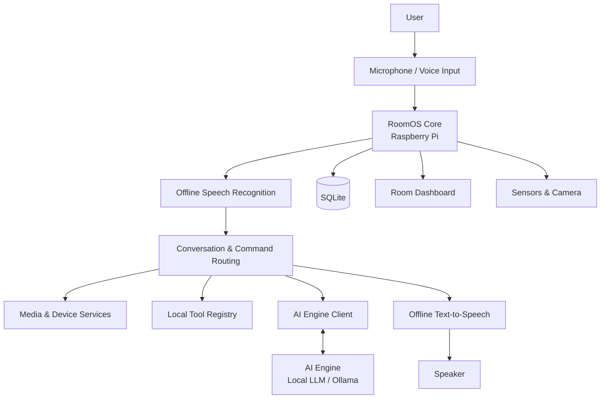

# RoomOS

**A local-first, AI-powered operating system for your room.**

RoomOS is a modular, edge-oriented intelligent room assistant that brings together voice interaction, conversational AI, media control, device management and environmental awareness into a unified system.

It is designed to run primarily on a Raspberry Pi, with an optional local AI compute node for more demanding inference workloads. RoomOS combines deterministic software services with local language models, allowing users to interact with their room naturally while keeping core functionality independent of cloud services.

## Architecture

RoomOS follows a **Pi-first, local-first architecture** with two primary components:

- **RoomOS Core (Raspberry Pi):** Owns application logic, device orchestration, voice interaction, command routing, media services, persistence, automation and tool execution.
- **AI Engine (optional compute node):** Hosts local language models and handles conversational inference and, eventually, more demanding capabilities such as embeddings, retrieval and multimodal perception.

The components communicate through application-level HTTP APIs. The AI Engine is optional: deterministic commands and core room functionality do not depend on LLM availability.



## Current Capabilities

### Voice Interaction
- Microphone audio capture and WAV processing using SoundDevice.
- Offline speech-to-text using Vosk.
- Offline neural text-to-speech using Piper.
- Asynchronous voice orchestration through a dedicated `VoiceAssistant`.
- FastAPI endpoint for initiating voice interactions.

### Conversational AI
- Separate AI Engine service powered by Ollama.
- HTTP-based communication between RoomOS Core and the AI Engine.
- Session-based conversation history persisted in SQLite.
- Integration of natural-language conversations with deterministic command routing.

### Command and Media Control
- Command routing for deterministic operations without requiring LLM inference.
- Media service abstraction separating playback logic from the underlying player.
- Fake media player adapter for development and testing.
- FastAPI endpoints for playback state, playback control and volume management.

### Local Tool System
Initial built-in tools have been implemented and tested independently:

- Date and time retrieval with timezone support.
- Safe arithmetic evaluation.
- Unit conversion.
- Asynchronous timers.
- System resource and health monitoring.

A tool registry provides a common execution interface. Native LLM-driven tool orchestration is currently under development.

## Technology Stack

| Area                | Technologies                  |
| ------------------- | ----------------------------- |
| Application backend | Python, FastAPI, Pydantic     |
| AI inference        | Ollama, local language models |
| Speech recognition  | Vosk                          |
| Speech synthesis    | Piper                         |
| Audio I/O           | SoundDevice, PortAudio        |
| HTTP communication  | HTTPX                         |
| Persistence         | SQLite                        |
| System monitoring   | psutil                        |
| Target hardware     | Raspberry Pi 3 Model B+       |
| Development AI node | MacBook Air M2                |

## Project Structure

```text
RoomOS/
├── config/
│   ├── ai_engine.yaml
│   └── logging.yaml
│
├── pi_controller/
│   ├── api/
│   │   └── routes/
│   ├── core/
│   ├── clients/
│   ├── devices/
│   ├── media/
│   ├── voice/
│   ├── tools/
│   │   └── builtin/
│   └── main.py
│
├── ai_engine/
│   ├── api/
│   ├── providers/
│   ├── services/
│   └── main.py
│
├── shared/
├── dashboard/
├── tests/
└── docs/
```

## Development

RoomOS is currently developed and tested on macOS, with the Raspberry Pi as the intended primary deployment target.

Start the AI Engine:

```bash
uvicorn ai_engine.main:app \
    --host 127.0.0.1 \
    --port 8001 \
    --reload
```

Start RoomOS Core in a separate terminal:

```bash
uvicorn pi_controller.main:app \
    --host 127.0.0.1 \
    --port 8002 \
    --reload
```

The Core service defaults to:

```bash
ROOMOS_AI_ENGINE_URL=http://127.0.0.1:8001
```

API documentation is available at:

`http://127.0.0.1:8002/docs`

Run the local tool tests from the repository root:

```bash
python -m tests.unit.test_tools
```

## Design Principles

- **Local-first:** Prefer local processing and storage; external services should not be required for core functionality.
- **Edge-oriented:** The Raspberry Pi owns room state and device orchestration.
- **Optional AI compute:** Language models and advanced inference can run on a separate machine without coupling core services to a specific provider.
- **Deterministic control:** Hardware and media operations use explicit application services rather than relying on LLM-generated actions.
- **Modularity:** Audio, AI inference, media, tools and device integrations have independent interfaces.
- **Privacy by design:** Camera and microphone data are processed locally by default, without requiring continuous cloud streaming.
- **Resource awareness:** Components and models are selected with the Raspberry Pi's hardware constraints in mind.

## Roadmap

- [x] FastAPI-based RoomOS Core and separate AI Engine.
- [x] Local conversational AI integration using Ollama.
- [x] SQLite-backed conversation persistence.
- [x] Offline speech recognition and speech synthesis.
- [x] End-to-end voice interaction.
- [x] Deterministic command routing and media service abstraction.
- [x] Initial local tool implementations.
- [ ] Complete LLM-driven tool execution and orchestration.
- [ ] Wake-word detection and continuous voice interaction.
- [ ] Webcam integration, motion detection and room presence awareness.
- [ ] Multimodal vision capabilities through the optional AI Engine.
- [ ] Plant monitoring and environmental sensing.
- [ ] Raspberry Pi deployment and hardware validation.
- [ ] Bluetooth audio output and music playback integration.
- [ ] Dashboard and room automation enhancements.

---

RoomOS is actively being developed as an integrated edge-AI and IoT system, with an emphasis on practical local intelligence, hardware integration and reliable everyday operation.